# AWS VPC Peering Project

## Project Overview
This project demonstrates AWS VPC Peering between two Virtual Private Clouds (VPCs), including routing configuration and private connectivity testing between EC2 instances.

## AWS Architecture

- **VPC A:** `10.10.0.0/16`
- **VPC B:** `10.20.0.0/16`
- **Bastion Host:** Public subnet in VPC A
- **App-A:** Private subnet in VPC A
- **App-B:** Private subnet in VPC B
- **VPC Peering:** Active

## AWS Services Used

- Amazon VPC
- VPC Peering
- Amazon EC2
- Route Tables
- Security Groups
- SSH

## Project Screenshots

### 1. VPC A and VPC B
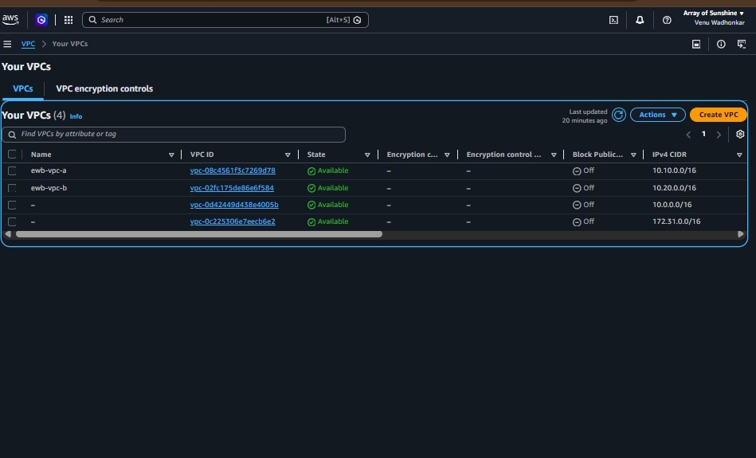

### 2. Subnets
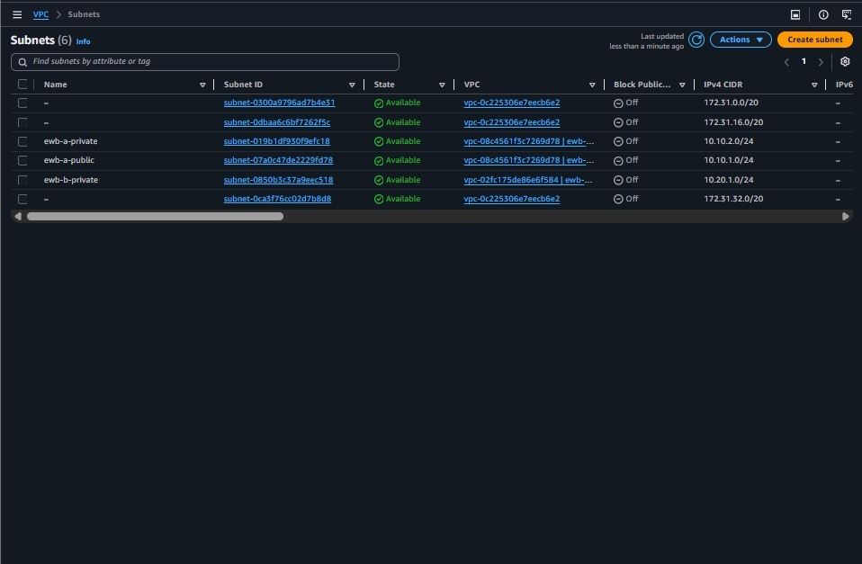

### 3. Public Route Table
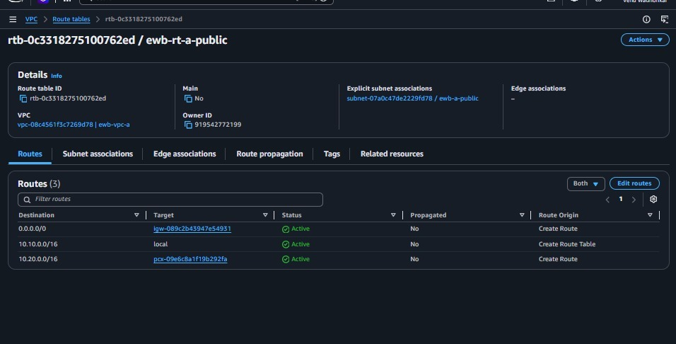

### 4. VPC A Private Route Table
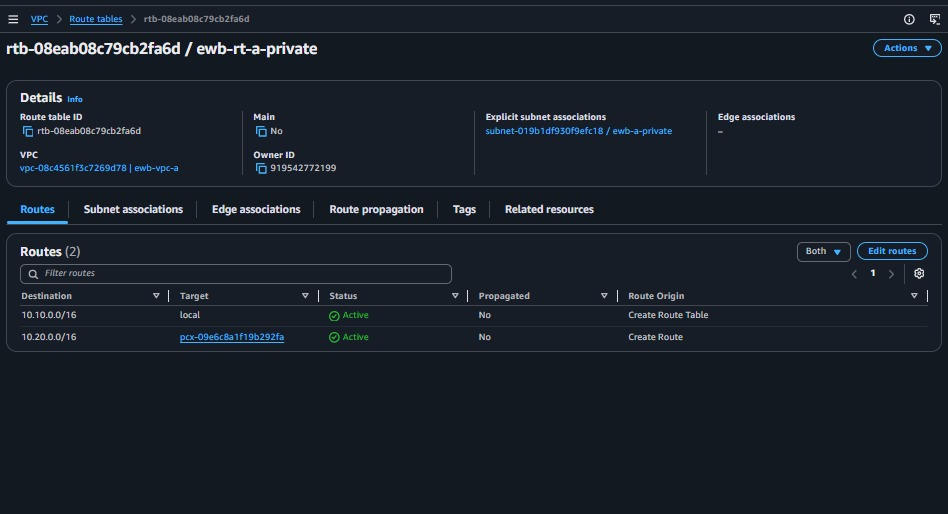

### 5. VPC B Private Route Table
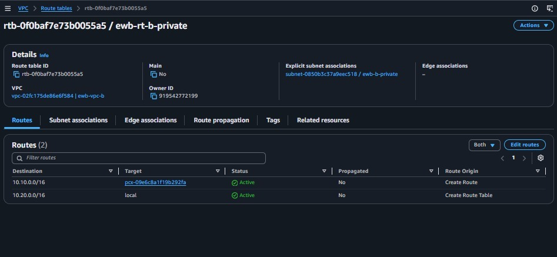

### 6. VPC Peering Active
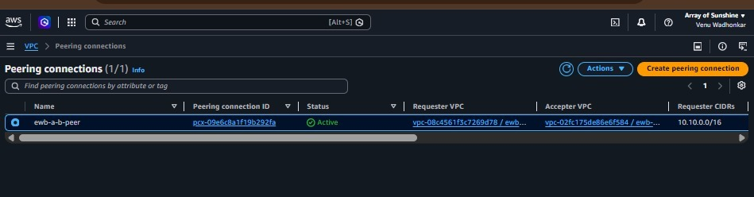

### 7. Security Groups
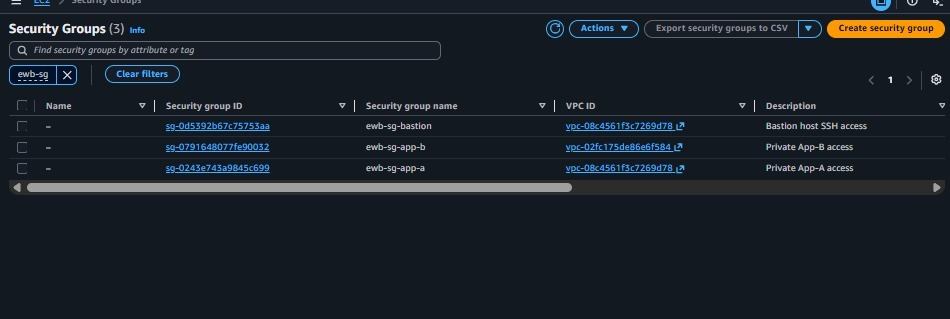

### 8. EC2 Key Pair
<!-- Confirm the exact filename in the repository before adding this image. -->

### 9. Bastion and App-A Instances
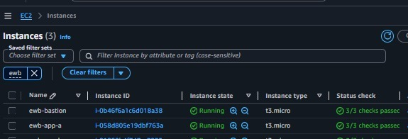

### 10. App-B Instance
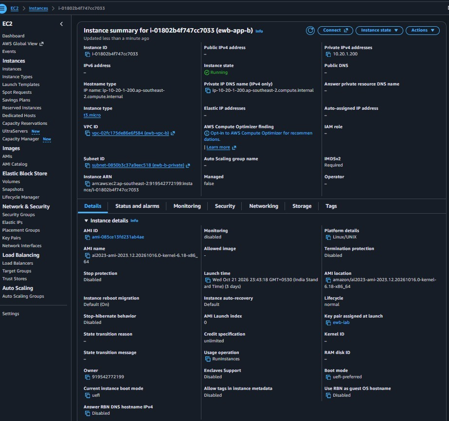

### 11. Bastion SSH Key Generation
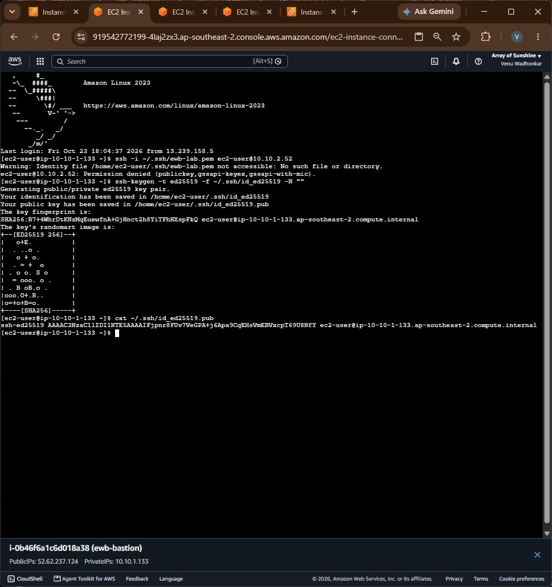

### 12. Bastion to App-A SSH
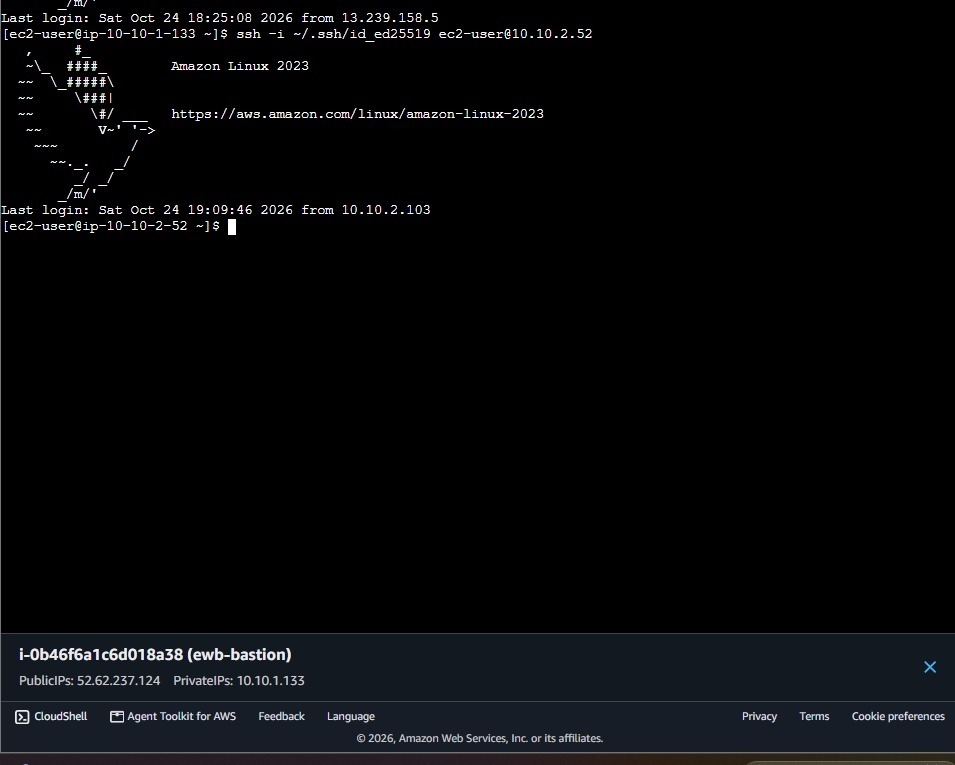

### 13. App-A to App-B SSH
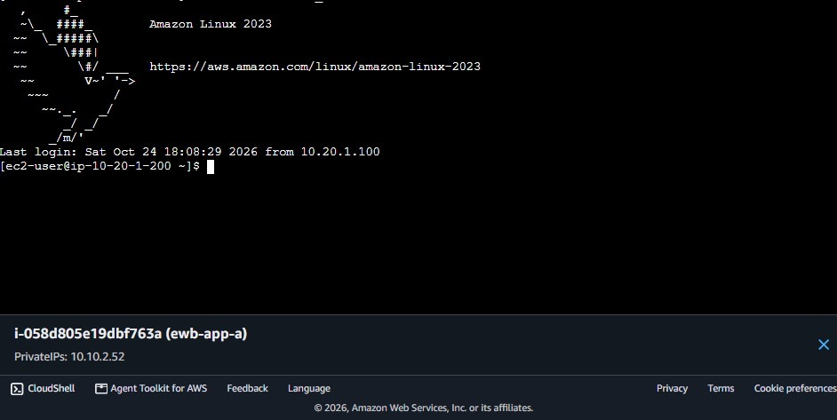

### 14. App-B to App-A Ping
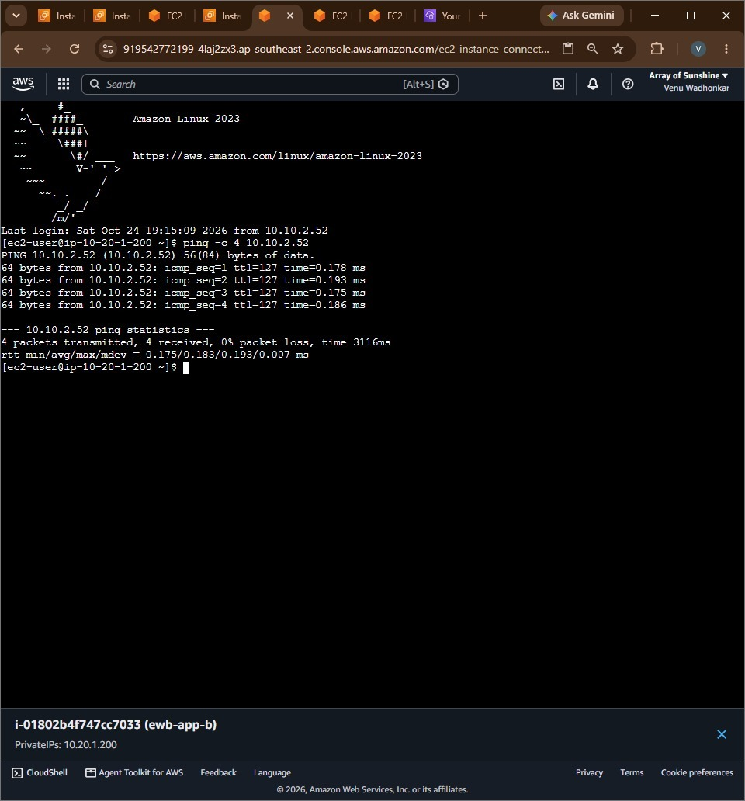

## Connectivity Results

- Bastion to App-A: SSH connection successful.
- App-A to App-B: SSH connection successful.
- App-B to App-A: Ping successful.

## Learning Outcomes

- Created and configured AWS VPCs and subnets.
- Configured route tables and VPC Peering.
- Practiced EC2 access using SSH.
- Tested private connectivity between instances.

## Security Note

Never upload private `.pem` keys, AWS access keys, passwords, or other credentials.

This project was completed as a hands-on AWS VPC Peering lab.
